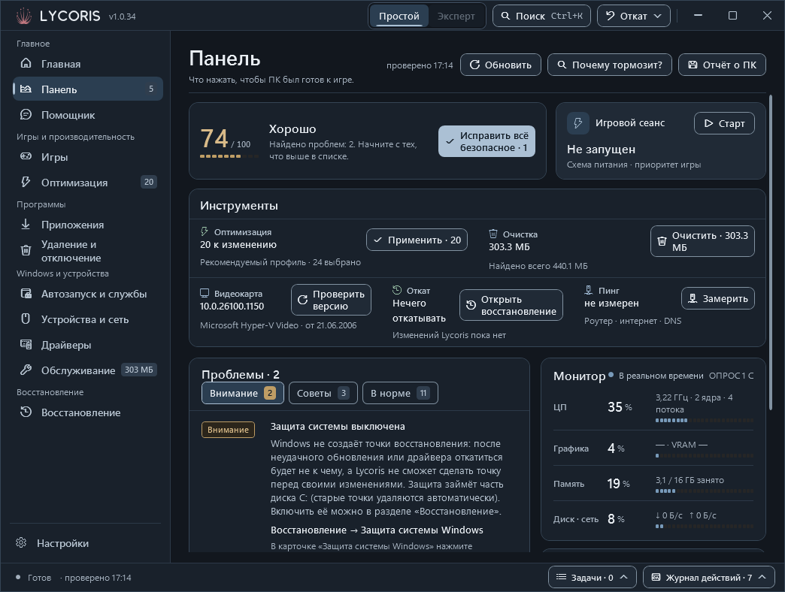
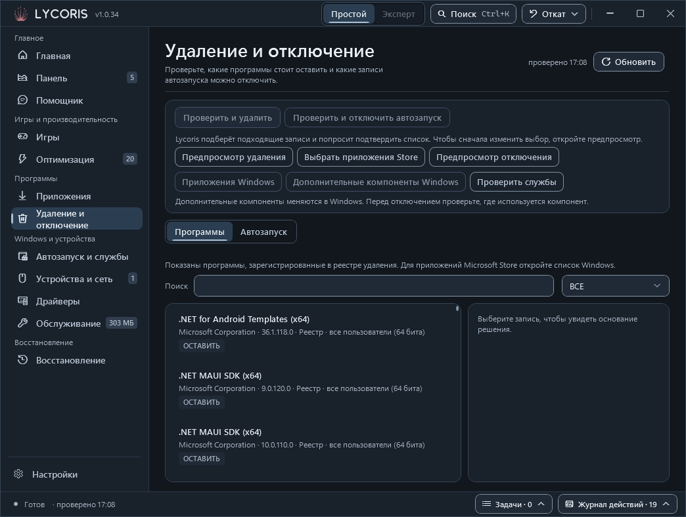
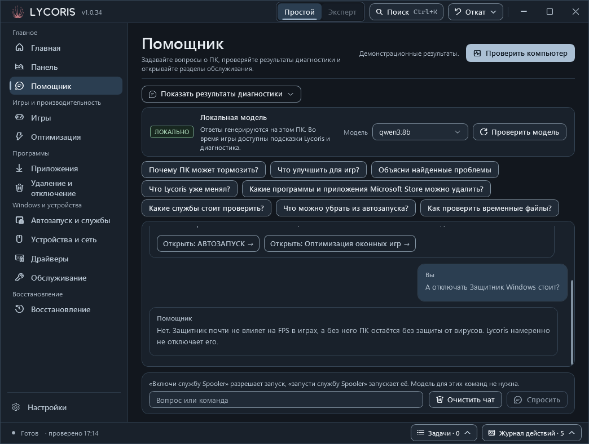
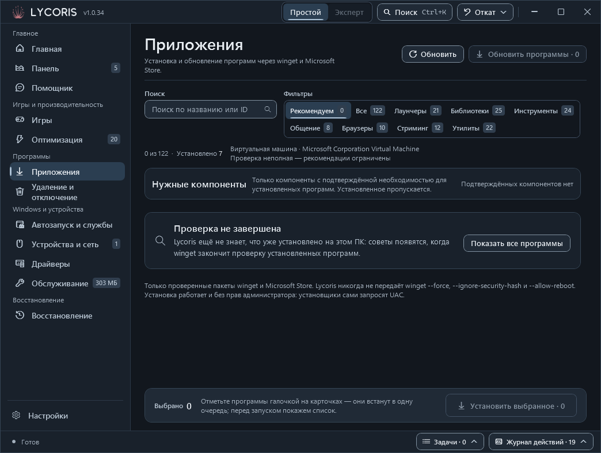

<p align="center">
  
</p>

**Lycoris — диагностика, обслуживание и настройка Windows под игры, работу и другие задачи.** Определяет тип ПК, объясняет найденные проблемы и предлагает изменения по подтверждённым данным.

**[Скачать установщик или portable](https://github.com/bil-xvii/Lycoris-releases/releases/latest)** · [Portable одним файлом — Lycoris.exe](https://github.com/bil-xvii/Lycoris-releases/releases/latest/download/Lycoris.exe)

Windows 10 2004+ / Windows 11, x64. .NET включён в загрузку. Интерфейс на русском и английском.

## Возможности

- **Состояние и тип ПК.** Мониторинг CPU, GPU, RAM, дисков и сети. Тип компьютера определяется по SMBIOS и данным корпуса; неизвестные и противоречивые сведения указаны явно.
- **Советы с понятным действием.** Панель показывает путь, следующий шаг и кнопку открытия нужного раздела Lycoris или Windows. Поддерживаемое исправление выполняется после подтверждения и проверяется повторно; неизвестная причина сбоя направляет к журналу надёжности.
- **Помощник.** Объясняет найденные проблемы и применяет поддерживаемые исправления. Без Ollama понимает «включи», «отключи», «запусти» и «останови службу…»: показывает точную цель и последствия, проверяет разрешения и результат. Для свободных вопросов доступен локальный чат через Ollama.
- **Программы и драйверы.** Рекомендации по подтверждённой потребности: например, игровые службы для обнаруженного Xbox. Ошибка сканирования или старый кэш не считаются отсутствием программы; ручной выбор сохранён.
- **Игры и профили.** Библиотека, избранное и GameBoost. Профили для игр, работы, стриминга и свой набор учитывают подтверждённую применимость аппаратных настроек. В разделе «Игры → Игровой сеанс → Закрытие программ → Настроить» можно разово закрыть выбранные программы. Перед этим Lycoris покажет процессы с PID и путями и попросит подтверждение.
- **Обслуживание.** Автозапуск и службы, анализ и очистка временных файлов, системные инструменты.
- **Удаление и отключение.** Две кнопки сканируют программы, автоматически выбирают подтверждённых кандидатов и после подтверждения точного списка выполняют действие. Подбор по данным установки, подписи и системным связям не ограничен перечнем названий; отдельный предпросмотр позволяет изменить выбор. Удаление идёт через штатный деинсталлятор WinGet и не отменяется журналом; отключение автозапуска сохраняет файлы и допускает откат. Классические программы и пакеты Store видны вместе. Системные компоненты и записи с недостаточными сведениями автоматически не выбираются.
- **Разбор служб.** Возможные будущие функции сохраняются через обратимую настройку запуска. Удаление остатков ограничено проверенными сценариями: сейчас только простой остаток Everything после подтверждения удаления программы; неизвестные службы не удаляются автоматически.
- **Приложения Store.** Отдельный список позволяет явно выбрать удаляемые приложения текущего пользователя. Перед удалением повторно проверяются регистрация и зависимости. Xbox, Game Bar, игровые службы, античит и системная инфраструктура защищены от автоматического удаления или отключения.
- **Контроль изменений.** Проверка ПК без изменений системы, предпросмотр и повторная проверка плана перед установкой. Подтверждение действий с правами администратора, журнал и откат поддерживаемых настроек.
- **Актуальные сведения.** Открытые списки программ, служб и автозапуска обновляются при возвращении в окно и по интервалу, когда нет игры или другой операции. Поиск новых версий продолжается при работе в трее; установка подтверждается и проверяет подпись релиза.

## Как выглядит

В версии **1.0.34** интерфейс оформлен в приглушённых графитовых и серо-синих тонах. На главной собраны состояние ПК и ближайшие действия. Боковое меню сгруппировано по задачам.

- **Главное** — Главная, Панель, Помощник.
- **Игры и производительность** — Игры, Оптимизация.
- **Программы** — Приложения, Удаление и отключение.
- **Windows и устройства** — Автозапуск и службы, Устройства и сеть, Драйверы, Обслуживание.
- **Восстановление** — Восстановление.

**Настройки** находятся внизу бокового меню.

**Главная — быстрые действия и история замеров.**


**Панель — сводка ПК, игровой сеанс, инструменты и результаты проверок.**



<details>
<summary>Удаление, помощник, приложения и игровая библиотека</summary>

**Удаление и отключение — проверка, предпросмотр и выбор программ.**



**Помощник — объяснения проблем и доступные действия.**



**Приложения — поиск, фильтры и статус проверки.**



**Игры — библиотека и настройки игрового сеанса.**


</details>

Снимки сделаны в тестовой среде с Lycoris **1.0.34**. История замеров на Главной и диалог Помощника демонстрационные. Показатели, списки и рекомендации зависят от компьютера.

## Перед запуском

Простой режим доступен всем. Экспертный режим пока доступен только автору на его ПК. Просмотр и диагностика работают без прав администратора; действия, требующие повышения прав, подтверждаются.

Откат предусмотрен для поддерживаемых настроек. Очистка файлов необратима; не каждое изменение можно отменить. Создание точки восстановления зависит от доступности и включённой защиты системы Windows. Результат оптимизации зависит от ПК и задачи — гарантий прироста FPS нет.

У приложения пока нет сертификата Authenticode: Windows может показывать неизвестного издателя. Сверяйте SHA-256 с файлом из релиза. Проверка подписи обновлений ECDSA — отдельный механизм и не заменяет подпись издателя Windows.

<details>
<summary>Для разработчиков: командная строка и сборка</summary>

## Командная строка

Сценарии раздела «Оптимизация» можно применить из консоли — с предпросмотром, журналом и откатом поддерживаемых настроек, как в интерфейсе. Точка восстановления зависит от настроек защиты Windows:

```
start /wait "" Lycoris.exe --apply-profile gaming            :: только план: каждый пункт «сейчас → станет», ничего не меняется
start /wait "" Lycoris.exe --apply-profile gaming --yes      :: применить (консоль от имени администратора, окно Lycoris закрыто)
echo %errorlevel%
```

Сценарии: `normal` («Работа и учёба»), `gaming` («Игры»), `recommended` («Рекомендуемый»). `--dry-run` всегда только показывает план. В PowerShell: `Start-Process .\Lycoris.exe '--apply-profile gaming' -NoNewWindow -Wait -PassThru`. Коды выхода: 0 — готово (или менять нечего), 1 — ошибки при применении, 2 — неверные параметры, 3 — нужны права администратора, 4 — Lycoris уже открыт, 5 — применено не всё, 6 — сбой.

Для разового закрытия программ укажите их имена через запятую, с расширением `.exe` или без него.

```text
Lycoris.exe --close-background-apps <имена> [--dry-run] [--force] [--yes --plan <64hex>] [--lang ru|en]
```

```bat
start /wait "" Lycoris.exe --close-background-apps 7zFM,SumatraPDF
start /wait "" Lycoris.exe --close-background-apps 7zFM,SumatraPDF --yes --plan PLAN_HASH
```

Замените имена в примере на выбранные программы и `PLAN_HASH` на значение поля `plan`. По умолчанию и с `--dry-run` команда пишет JSON предпросмотра в стандартный вывод. В нём есть PID, время запуска и полный путь каждого процесса. Поле `plan` содержит 64-символьный SHA-256 отпечаток набора процессов и режима закрытия.

Для выполнения используйте консоль с правами администратора, повторите имена и передайте `--yes --plan` с отпечатком. Перед закрытием Lycoris сверяет весь набор процессов с подтверждённым планом. Если состав изменился, сформируйте новый план. Окно Lycoris может оставаться открытым. `--force` разрешает принудительное завершение процессов, оставшихся после обычного закрытия. Укажите его и в предпросмотре, и при выполнении плана. Объём памяти в предпросмотре указан для справки. Выбор процессов задаётся только переданными именами.

## Сборка из исходников (нужен .NET 10 SDK)

```
dotnet build src/Lycoris/Lycoris.csproj -c Debug
dotnet test tests/Lycoris.Tests/Lycoris.Tests.csproj
powershell -ExecutionPolicy Bypass -File tools\publish.ps1     # Release-сборка в publish\Lycoris.exe
```

</details>

## English

**Lycoris brings Windows diagnostics, maintenance and settings for gaming, work and other tasks into one app.** Monitor hardware and identify the PC type from SMBIOS and chassis data, with unknown or conflicting facts stated explicitly. App recommendations require a confirmed need; failed scans and cached data do not prove a program is missing. Gaming, work, streaming and custom profiles respect verified hardware applicability. Review the plan before changes; installation plans are checked again. Manage games, GameBoost, startup, services and cleanup. Basic Assistant guidance works without a local AI model; Ollama chat is optional.

**[Download installer or portable](https://github.com/bil-xvii/Lycoris-releases/releases/latest)** · [Portable EXE](https://github.com/bil-xvii/Lycoris-releases/releases/latest/download/Lycoris.exe)

The Assistant also handles explicit enable, disable, start and stop service requests without Ollama, with an exact plan and verified outcome. Start policy and current running state are separate. Service residue removal currently supports only a constrained Everything remnant after you confirm the program was uninstalled; unknown services are not deleted. Supported removal records can be restored disabled, including from Simple mode.

The separate **Uninstall and disable** panel scans desktop registrations and Store packages, explains its decisions, and automatically selects candidates supported by installation, signature and system evidence rather than a fixed list of app names. Its two main buttons scan, request confirmation of the exact selection and then execute. An editable preview is also available. Desktop removal uses the native WinGet uninstaller and cannot be undone through Lycoris; supported startup changes can be restored. Uncertain Store removals remain in Windows Settings. Gaming and streaming presets use an applicable Balanced plan, preserving compatible OEM plans. Automatic disk cleanup and other settings with trade-offs remain individual choices.

In **Games → Game session → Closing programs → Set up**, use **Close selected now** for a one-time closure. Lycoris previews the process IDs and paths, then asks you to confirm. The list can be saved separately for game sessions.

Windows 10 2004+ / Windows 11 x64; .NET included; RU/EN interface. Simple mode is available to everyone; Expert mode is currently limited to the author's PC. Review and confirm changes requiring administrator rights. Only supported settings can be rolled back; file cleanup is irreversible. Restore points require available and enabled Windows System Protection. Performance gains are not guaranteed.

Dashboard advice includes the exact destination, next step and an Open button. Supported fixes require confirmation and a fresh result check. Selected current-user Store applications can be removed after identity and dependency checks; Xbox and Game Bar infrastructure remain protected. Visible software and service lists refresh when idle, and release checks continue during long tray sessions. Update installation remains confirmed and signature-verified.

### Interface in 1.0.34

Version **1.0.34** uses muted graphite and slate tones. Home brings together PC status and suggested actions. The sidebar groups pages by task.

- **Overview** — Home, Dashboard, Assistant.
- **Gaming and performance** — Games, Optimize.
- **Programs** — Apps, Remove & disable.
- **Windows and devices** — Startup & services, Devices & network, Drivers, Maintenance.
- **Restore** — Restore.

**Settings** is at the bottom of the sidebar.

The screenshots show Lycoris **1.0.34** in a test environment. The measurement history on Home and the Assistant conversation are demos. Readings, lists and recommendations vary by PC.

The app has no Authenticode certificate yet, so Windows may show “Unknown publisher”. Verify the release SHA-256; ECDSA update verification is separate from Windows publisher signing.

[Лицензия / License](LICENSE.md)
