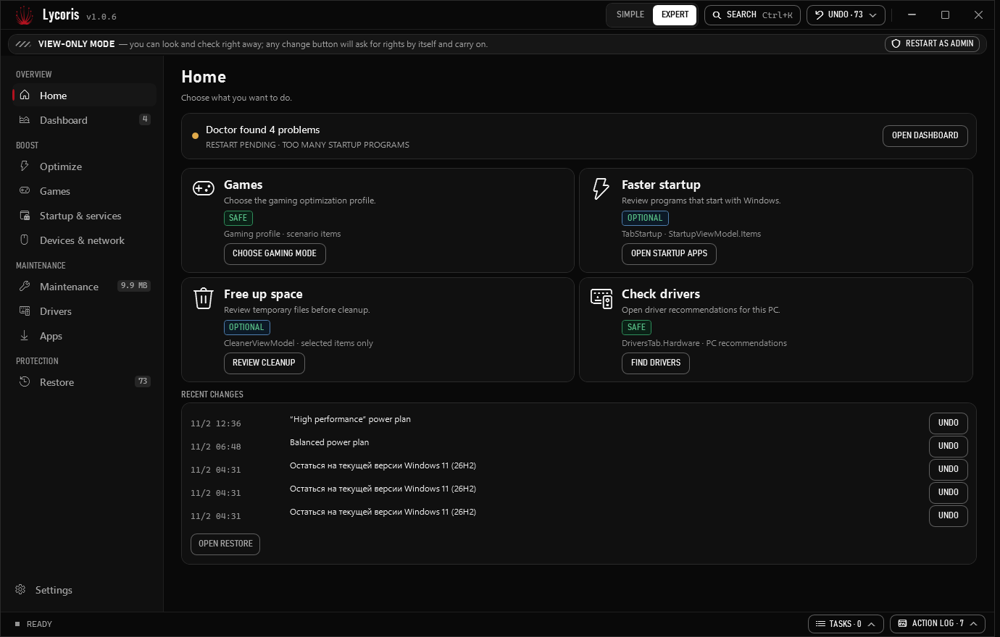
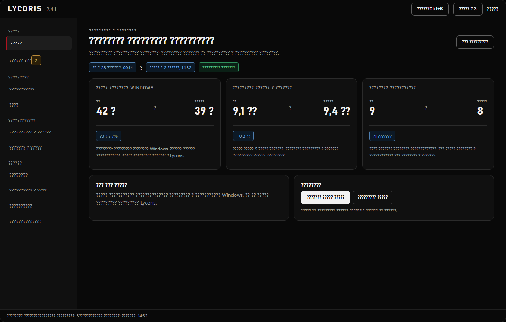
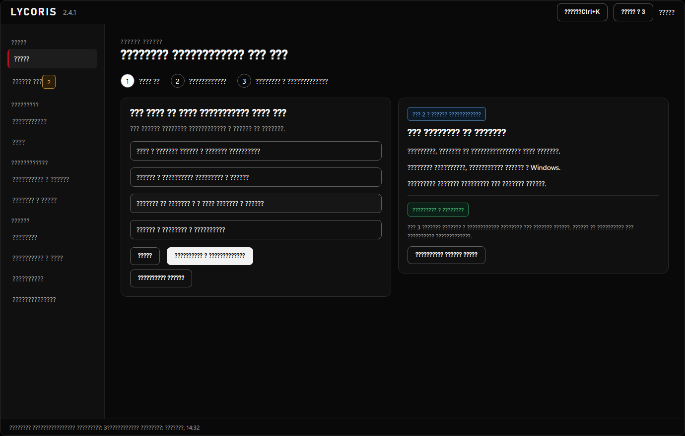
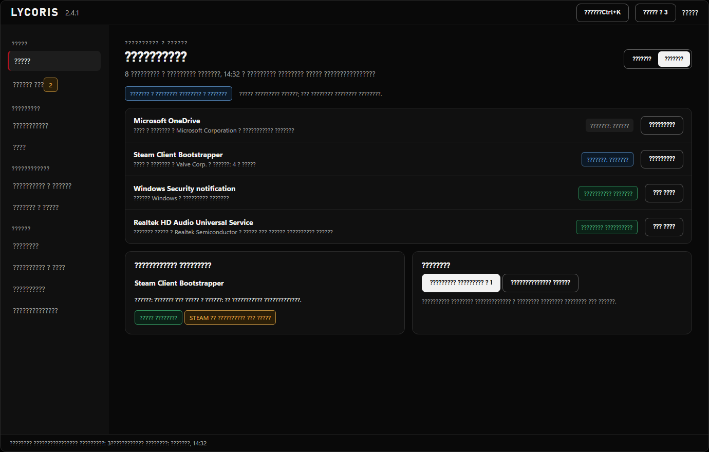

# Lycoris

Lycoris — приложение для Windows с настройками системы, журналом изменений и доступным откатом поддерживаемых действий. Перед применением изменения показываются пользователю.






## Требования

Windows 10 версии 2004 (сборка 19041) или Windows 11, x64.

## Загрузка и проверка

Скачивайте `Lycoris.exe` и `Lycoris.exe.sha256` из [последнего выпуска](https://github.com/bil-xvii/Lycoris-releases/releases/latest). В PowerShell в папке загрузки проверьте SHA-256:

```powershell
$expected = ((Get-Content .\Lycoris.exe.sha256 -Raw).Trim() -split '\s+')[0]
$actual = (Get-FileHash .\Lycoris.exe -Algorithm SHA256).Hash
if ($actual -ne $expected) { throw 'SHA-256 не совпадает' }
```

Хеш подтверждает целостность относительно опубликованного файла с хешем; сам по себе он не устанавливает личность издателя.

## Установка

- **Portable:** запустите `Lycoris.exe` из выбранной папки.
- **Установщик:** скачайте `Lycoris-Setup-<версия>.exe`, запустите и следуйте мастеру. Установка доступна текущему пользователю.
- **winget:** пакет `bil-xvii.Lycoris` появится после принятия и публикации манифеста сообществом в Microsoft winget-pkgs.

## Безопасность и данные

Lycoris показывает выполняемые действия, а поддерживаемые изменения записывает в журнал, из которого их можно отменить. Возможность отката зависит от конкретного действия и состояния Windows. Подробности локального хранения и сетевых обращений — в [политике конфиденциальности](https://github.com/bil-xvii/Lycoris/blob/main/docs/privacy.md).

## Сообщить о проблеме

Создайте issue в [репозитории проекта](https://github.com/bil-xvii/Lycoris/issues) с версией Windows, версией Lycoris и шагами воспроизведения. Перед публикацией логов проверьте их и удалите личные сведения.

---

# Lycoris (English)

Lycoris is a Windows application for reviewing system settings, with a change journal and rollback for supported actions. Changes are shown to the user before they are applied.

## Requirements

Windows 10 version 2004 (build 19041) or Windows 11, x64.

## Download and verify

Download `Lycoris.exe` and `Lycoris.exe.sha256` from the [latest release](https://github.com/bil-xvii/Lycoris-releases/releases/latest). In PowerShell, from the download folder:

```powershell
$expected = ((Get-Content .\Lycoris.exe.sha256 -Raw).Trim() -split '\s+')[0]
$actual = (Get-FileHash .\Lycoris.exe -Algorithm SHA256).Hash
if ($actual -ne $expected) { throw 'SHA-256 mismatch' }
```

The hash checks integrity against the published hash file; it does not by itself establish the publisher's identity.

## Installation

- **Portable:** run `Lycoris.exe` from a folder of your choice.
- **Installer:** download `Lycoris-Setup-<version>.exe` and follow the wizard. It installs for the current user.
- **winget:** `bil-xvii.Lycoris` will be available after its community manifest is accepted and published in Microsoft winget-pkgs.

## Safety and data

Lycoris shows actions before applying them and records supported changes in a journal that can be used to undo them. Rollback depends on the action and current Windows state. See the [privacy information](https://github.com/bil-xvii/Lycoris/blob/main/docs/privacy.md) for local storage and network details.

## Report a problem

Open an issue in the [project repository](https://github.com/bil-xvii/Lycoris/issues) with your Windows and Lycoris versions and reproduction steps. Review logs and remove personal information before sharing them.
